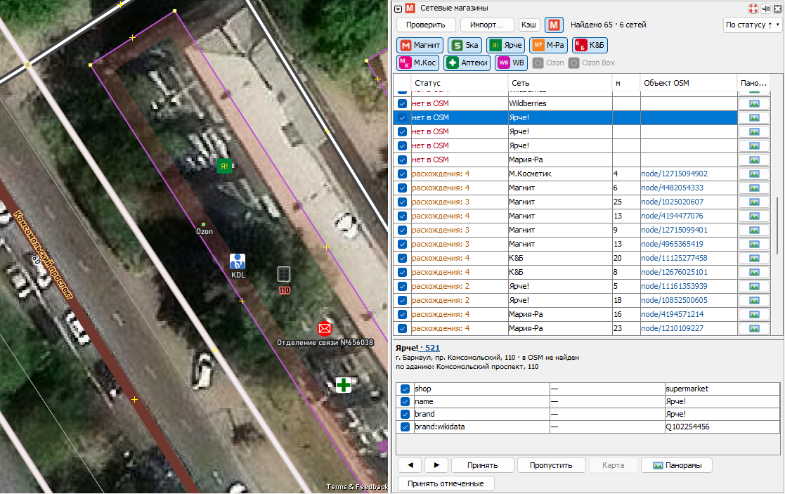
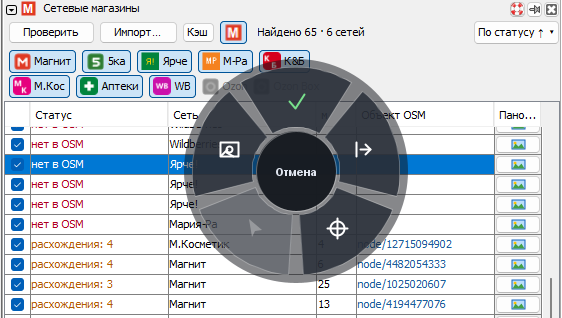

# chainpoi — chain stores in JOSM

[Русский](README.md) | **English**

The plugin checks chain stores against OSM data: what is missing, which tags
differ, and (per checkbox) creates objects in the current layer.

Supported chains: **Magnit** (`MM`, `MC`, `GM`, `MM_MINI`),
**M.Kosmetik** (`DG`), **Pyaterochka** (source: the chain's job vacancy database),
**Krasnoe&Beloe** (the chain's address catalogue), **Wildberries**
(a ~75 MB pickup-point file downloaded after confirmation), **Rigla**
(official GraphQL pharmacy list), **Yarche!**, **Maria-Ra**, and fuel
stations: **Lukoil**, **Gazpromneft**, **Tatneft**, **TAIF-NK**, **Topline**.



## How it works

1. Load an area in JOSM as usual (OSM data must be in the layer).
2. Menu **Data → Check chain stores** (or `Ctrl+Shift+F9`).
3. The plugin takes the visible area, requests the chain stores and matches them
   against the layer — and the other way round: it looks for chain stores in OSM
   that the chain no longer has there.
   Below the buttons there are per-chain toggles with icons: an enabled chain is
   checked, a disabled one turns grey and disappears from the table, so not all
   stores are mixed together.
   Magnit, M.Kosmetik and Pyaterochka are queried directly. Pyaterochka comes
   from the rabota5ka.ru vacancy database, so only stores that are hiring appear.
   Disabled chains are not queried at all.
   For **Krasnoe&Beloe** the plugin asks permission on the first check: about
   76 requests to the chain's catalogue, 6–7 MB. It remembers region bounds and
   afterwards requests only the regions near the current area; only stores in
   that area are cached. If you decline, the chain is skipped for this check.
   For **Wildberries** the plugin downloads one ~75 MB file (~72k pickup points);
   permission is asked for the first area, and only nearby pickup points are
   cached. Parcel lockers are skipped for now: in OSM they are
   `amenity=parcel_locker`, not pickup points.
   **Rigla** is fetched with one GraphQL request (~1k pharmacies).
   **Yarche!** is fetched from 31 regional pages with addresses and coordinates:
   all on the first run, then only nearby regions. **Maria-Ra** comes from one
   “Store map” page containing JSON points and hours. **Lukoil**,
   **Gazpromneft**, **Tatneft**, **TAIF-NK** and **Topline** fuel stations come
   from the chains' official locators after confirmation; fuel types are
   written as `fuel:diesel`, `fuel:octane_92`, `fuel:octane_95`, etc.
   The cache is stored in 1°×1° tiles and only for areas you have checked:
   mapping in Krasnodar does not put Far East fuel stations on disk. Data is
   refreshed every 7 days; tiles not requested for a month are deleted. The
   **Кэш** button clears all saved lists; the next check downloads them again.
   All pharmacy chains share one **Аптеки** toggle (the “+” icon).
   For Ozon (and other chains without an open API) there is an **Import…**
   button — see [bookmarklets/README.md](bookmarklets/README.md).
   The plugin-icon button in the top row shows chain badges on the map.
4. The table lists the results. Statuses:
   - `not in OSM` — no object, a point can be created;
   - `differences: N` — the object exists, but tag values differ;
   - `mapping error` — the store is placed on a building outline or on an entrance;
   - `ok` — everything matches;
   - `created` — the point was created in this layer and not uploaded yet;
   - `skipped` — the row was skipped; with sorting off it stays in place and is
     shown in grey;
   - `not checked` — a chain object exists in OSM, but the source is incomplete
     (Pyaterochka vacancies): nothing to compare, view/panoramas only;
     only objects inside the checked area are listed;
   - `not in chain data` — OSM has a store the chain doesn't have here
     (possibly closed);
   - `other format` — a nearby `М.Кос` (beauty format), not M.Kosmetik;
     its name is shown in the row status and its `name`/`shop` tags in the
     details; opening hours are always listed (read-only when they match),
     name and `shop` are untouched.
5. Selecting a row shows the details below: full address (small font), OSM
   object, distance, warnings and the list of fields **"in OSM → chain"** with a
   checkbox per change (all checked).
   The object is not selected on the map. Double-click or the **Map** button
   centre it, set a scale of about 80 m, so the building is clearly visible, and
   highlight the object for a couple of seconds; if the store is not in OSM yet,
   a chain icon with a halo is shown at its location for a moment instead.
   **Select on map** in the row context menu selects it without changing the
   scale.
6. Buttons: `◀` `▶` — navigate, **Accept** — apply to this object,
   **Skip**, **Map** — centre, **Closed** (for `not in chain data` rows).
   **Panoramas** — an icon in every table row and a button in the details:
   opens Yandex Maps with the panorama layer.
   The same actions are in the row context menu (right-click): **Accept**,
   **Skip**, **Show on map**, **Select on map** and **Panoramas**. A short
   right-click opens the normal menu, a long press opens the circular action
   menu.
   
   The store code in the card header is a link: clicking it opens a menu with
   Yandex Maps and 2GIS (both maps open at the store point, ~80 m scale). The
   `node/…` link in the "OSM object" column opens the object on osm.org.
   Reviewed and skipped rows move to the bottom of the list.
7. **Accept checked** does the same for all checked rows, with a confirmation
   and a list of what will change. The sort button above the table shows the
   current mode, e.g. **“По статусу ↑ ▾”**. The menu offers status, chain, type
   and no sorting; ascending/descending is selected separately. In “Без
   сортировки” mode rows stay in place and do not jump after applying.
8. Uploading to OSM is up to you and your account.

Overpass is not used: matching is done against what is already loaded in the
layer. So download the area in JOSM first, otherwise existing stores will look
missing.

After applying, the object stays selected on the map and a reminder appears
below the table: the new point is placed at the chain coordinates (usually the
entrance), so it is worth checking and dragging if needed. In the field list
after applying, the old value is struck through and the new one is shown
normally.

## Data source in the changeset

When the plugin applies chain data, it adds the `source:chainpoi` changeset tag
with the chain websites (`magnit.ru`, `rabota5ka.ru`, etc.) and appends the same
addresses to `source`. You can see it in the upload dialog on the "Tags" tab;
it is never put on OSM objects.

## What is compared

| Field | How it is compared |
|---|---|
| `shop` | exact value (`supermarket` / `convenience`); for «Моя цена» they are equivalent |
| `name` | case, ё/е and quotes ignored; "магазин Магнит" ≠ "Магнит" |
| `brand`, `brand:wikidata` | exact value |
| `operator` | quotes and "АО" ignored |
| `opening_hours` | spaces ignored; `Mo-Su 09:00-21:00` ≠ `Mo-Su 08:00-20:00` |
| `addr:street`, `addr:housenumber` | only if already present on the object |

A store may be a node, a **polygon** or a **multipolygon** — that is not an error.
An error is a node on a building outline (a vertex of `building=*`) or on an
object with `entrance`/`door`.

The plugin treats name, hours and operator as the chain's responsibility:
differences are shown and offered for replacement by default.

`branch` is not created (Magnit's API has none), but if present in OSM it is
shown in the details.

## How it was tested

The provider, matching and command building were tested without the UI
(`test` folder, `javac` + `java` against `josm-latest.jar`):

- `TestFetch` — a real request to the Magnit API, parsing of the response and tags;
- `TestMatch` — tag values (hours, "магазин Магнит", operator), polygon,
  multipolygon, node on a building outline, entrance/door, a distant object,
  "Магнит Косметик" and "Магнит Аптека" nearby (must not count as Magnit),
  plus M.Kosmetik: old name, new name, `shop=cosmetics` ≡ `chemist`;
- `TestApply` — command building: creating a point without an address, selective
  application (an unchecked field is not applied), closing a store
  (`shop` → `disused:shop` + `check_date`), unchecked rows;
- `TestReal` — matching against real OSM data downloaded via the API.

Run with one command, the result goes to `test/report.txt`:

```
powershell -NoProfile -ExecutionPolicy Bypass -File test/run-tests.ps1
```

Manually checked in JOSM: the panel appears, the **Check** button works,
creating a missing store with **Accept**, the new point is selected, the
reminder below the table, and the table refresh after applying.

## Tags

A new node is created with:

```
shop=supermarket            (MM, MC, GM)   convenience for MM_MINI
name=Магнит
name:ru=Магнит
name:en=Magnit
brand=Магнит
brand:wikidata=Q940518
operator=АО «Тандер»
opening_hours=Mo-Su 08:00-20:00
```

Address tags are not added: if the point is inside a building, the address is
already on the outline, and duplicating it on the point is debatable. The
details show it as a hint "from the building: …".

The set matches the Magnit preset in iD/NSI (`shop`, `brand`, `brand:wikidata`,
`name`, `name:ru`, `name:en`) plus `operator` and `opening_hours`. `brand:en`/`brand:ru`,
chain contacts and `brand:wikipedia` from the Russian preset are intentionally
not added.

For **Krasnoe&Beloe** a new point gets `shop=alcohol`, `name`/`name:ru` and
`brand` = «Красное&Белое», `brand:wikidata=Q24933790`, `opening_hours` from the
catalogue. 98% of the chain's OSM objects are tagged this way; the address is
not duplicated, same as for Magnit.

For **Wildberries** a pickup point gets `shop=outpost`, `name`/`name:ru`/`brand`
= Wildberries, `brand:wikidata=Q24933714`. Lockers are not created — OSM uses
a different tagging scheme for them.

For **Rigla** — `amenity=pharmacy`, `name`/`name:ru`/`brand` = «Ригла»,
`brand:wikidata=Q4394431`, `healthcare=pharmacy`. From the group feed only
points with "Ригла" in the name are used; partner pharmacies are left alone.

For **Yarche!** — `shop=supermarket`, `name`/`brand` = «Ярче!»,
`brand:wikidata=Q102254456`. Coordinates come from `data-coords` on the site.

For **Maria-Ra** — `shop=supermarket`, `name`/`brand` = «Мария-Ра»,
`brand:wikidata=Q4281631`. If the map provides opening hours, they are added
as `opening_hours`.

For fuel stations the plugin writes `amenity=fuel`, `name`/`brand` and
`brand:wikidata`. Fuel types from the official locators become
`fuel:diesel`, `fuel:octane_80/92/95/98/100`, `fuel:lpg`, `fuel:cng` and
`fuel:lng`.

For 53 fuel chains without an open API, import and recognition profiles are
included: Rosneft, Teboil, Gazprom, Bashneft, Neftmagistral, Kalina Oil,
Dvizhenie, ORTK, VTK, PRIME, Baltneft, LTK, Kirishiavtoreservis,
Atan, Rusoil, OPTI, Ufimneft, PNB, Yuzhnaya Neftyanaya Kompaniya, Gazoil,
KNP, Ekoil, Neftekhimprom, V&V, Likom, Surgutneftegaz, TamicEnergy,
Get Petrol, UralKontraktNeft, Zyuratkul, Nyagan-gaz, Oktan, BRK, Lyuksoil,
Kraysneft, Region 24, Nika, Gaznefteprodukt, TransSib, Sibirneft, NNK,
Sakhaneftegazsbyt, Nefetmarket, Tuymaada-neft, Oktant, Benzo, NK Ussuri,
Dalnefteprodukt, EKA, TES, IRBIS, Trassa and Sibnefteprodukt. They download
nothing and add no buttons: load points with **Import…**, and the plugin
recognises OSM objects by `brand`/`name`.

**Topline** (Omsk and the eastern direction, 60 stations) is an experiment:
the plugin first matches by textual address — `addr:street` +
`addr:housenumber` — without relying on coordinates. If no address match is
found, it falls back to the usual coordinate search. Address matches are
flagged in the details so they can be checked by eye.

The station number belongs in `ref` — without “№” and the word “АЗС”,
for example `ref=5`. `name` should be the brand or the station's own name,
not “АЗС №5”. If `name` contains a number,
the plugin warns about it and proposes moving the number to `ref` while
cleaning `name` to the chain name.

## Store formats

| API code | What it is | How it is handled |
|---|---|---|
| `MM` | Magnit | `shop=supermarket` |
| `MC` | Magnit "Moya tsena" | `shop=supermarket` |
| `GM` | Magnit Semeyny | `shop=supermarket` |
| `MM_MINI` | Magnit Mini | `shop=convenience` |
| `DG` | M.Kosmetik | separate chain, `shop=chemist` |
| — | Pyaterochka | `shop=supermarket`, source: vacancies |
| `DARKSTORE` | Migom | skipped |
| `ZARYAD` | Zaryad | skipped |
| `MO`, `ME` | unknown | skipped |

`DG` was verified by address: Gulkevichi, Leningradskaya st. 20 — `DG` in the API.
`MC` was verified at Rasshevatskaya 95, Temizhbekskaya.

### M.Kosmetik

On 14 Nov 2025 Magnit officially relaunched the chain: "Магнит Косметик" →
**"М.Косметик"** (drogerie and household). Beauty stores focused on cosmetics
and perfume only are a separate brand, **"М.Кос"**; that is no longer a drogerie,
so `shop=cosmetics` on an "М.Косметик" object is considered wrong and is offered
to be replaced with `shop=chemist`.

It is a separate chain: `DG` stores are matched only against objects whose
`name`/`brand` contains "косметик", and are not confused with regular Magnit.

New points are created with `name=М.Косметик`, `name:ru=М.Косметик`,
`brand=Магнит Косметик`, `shop=chemist`.

For existing objects `name` and `name:ru` are ordinary differences: they are
shown and offered for application (the rebranding is official, the decision for
each object is yours). The plugin does not touch `brand` on M.Kosmetik.

The API does not distinguish the "М.Кос" beauty cluster: all cosmetics stores
come as `DG` and are treated as M.Kosmetik. It is rare — beauty stores exist
only in large cities (about 10% of the chain), so in practice it almost never
occurs. If an OSM object is named "М.Кос", the plugin shows it as "other format"
and compares only its opening hours.

Next to a name difference a notice is shown: the rename comes from the chain's
official rebranding, **not from an OSM community decision**, and the sign on
panoramas may still be the old one. The **Panoramas** button opens Yandex Maps
with the panorama layer on the store — then click a blue line.

You may look at the map, but **you may not use its data**: only panorama photos
are allowed, without the map background, address labels or satellite imagery
(see [RU:Россия/Яндекс.Панорамы](https://wiki.openstreetmap.org/wiki/RU:%D0%A0%D0%BE%D1%81%D1%81%D0%B8%D1%8F/%D0%AF%D0%BD%D0%B4%D0%B5%D0%BA%D1%81.%D0%9F%D0%B0%D0%BD%D0%BE%D1%80%D0%B0%D0%BC%D1%8B)).
The plugin reads nothing from the map — it only opens it in the browser.

## Build

No Gradle: the plugin is built against a local `josm-latest.jar`.

Windows:

```
powershell -NoProfile -ExecutionPolicy Bypass -File build.ps1
```

macOS and Linux:

```
./build.sh
JOSM_JAR=/path/to/josm-latest.jar ./build.sh
```

`build.ps1` has the JDK and jar paths at the top; `build.sh` takes the jar path
from `JOSM_JAR` (default `~/Downloads/josm-latest.jar`). JDK 17+ is required.

## Install

Ready-made archives are in the [release](https://github.com/Glebzilla/josm-chainpoi/releases):
`chainpoi-0.3.4-windows.zip` for Windows and `chainpoi-0.3.4-macos-linux.zip`
for macOS and Linux. Each contains the jar, the install script and short notes.

**JOSM must be closed**: otherwise it overwrites `preferences.xml` on exit.
The plugin lives in JOSM's settings directory, which differs per system:

| System | JOSM directory |
|---|---|
| Windows | `%APPDATA%\JOSM` |
| macOS | `~/Library/Preferences/JOSM` |
| Linux | `~/.config/JOSM` (or `~/.josm` if that directory exists) |

### Windows

```
powershell -NoProfile -ExecutionPolicy Bypass -File install.ps1
```

The script copies `chainpoi.jar` to `plugins`, backs up `preferences.xml` and
adds `<entry value='chainpoi'/>` to the plugin list.

### macOS and Linux

```
sh install.sh
```

The script finds the JOSM directory itself (see the table), copies the jar,
backs up `preferences.xml` and adds the entry. If the `plugins` directory does
not exist yet, start JOSM once, close it and run the script again.

### Manually (any system)

1. Close JOSM.
2. Copy `chainpoi.jar` to `<JOSM directory>/plugins/`.
3. In `<JOSM directory>/preferences.xml` find `<list key='plugins'>` and add
   the line `<entry value='chainpoi'/>`.
4. Start JOSM.

## Uninstall

Close JOSM, delete `<JOSM directory>/plugins/chainpoi.jar` and the
`<entry value='chainpoi'/>` line from `<list key='plugins'>` in `preferences.xml`.

## Limitations

- Providers: Magnit (with M.Kosmetik) and Pyaterochka. Other chains plug in
  through the `ChainProvider` interface.
- Matching by distance (100 m) and name/brand match. "Магнит Косметик" and
  "Магнит Аптека" are intentionally not treated as Magnit.
- The address is not added: it is usually already on the building. The address
  from the outline is shown as a hint in the details.
- A new point is placed at the chain coordinates — usually the entrance — so it
  may end up slightly outside the building outline. After applying, the point
  stays selected and can be dragged right away.
- "Not in chain data" is only a hint: the distance can be large, so the decision
  to close is made by a human (the "Closed" button).
- Pyaterochka: the source is the rabota5ka.ru vacancy database, so only stores
  that are hiring appear; closures cannot be detected from it. Coordinates in
  vacancies are often inaccurate, so the matching radius for it is 250 m.
- The "Panoramas" button opens Yandex Maps with satellite and the panorama layer,
  but panoramas are not available everywhere. You may look at the map, but you
  may not use its data (background, labels, imagery) — only panorama photos.
- The plugin uploads nothing to the OSM server.
- Data comes from the chain's website. Before uploading, make sure the store is
  really there: satellite, panorama, on the ground.

## Roadmap

- Ozon — postponed: its map returns points as tiles/widgets and needs separate work.
  Wildberries is already supported via the static JSON. VTB ATMs — after that.
- Highlighting proposed points on the map in a separate temporary layer.
- Configurable distance threshold and checked tag set.
- Filling `addr:*` from the building outline behind a separate checkbox.

## Development

Parts of the code and documentation were prepared with AI assistance, then
reviewed, built and tested by the author. The plugin never uploads data to OSM
automatically.

## License

GPL-3.0, see [LICENSE](LICENSE).

## See also

- [RU:Россия/Яндекс.Панорамы](https://wiki.openstreetmap.org/wiki/RU:%D0%A0%D0%BE%D1%81%D1%81%D0%B8%D1%8F/%D0%AF%D0%BD%D0%B4%D0%B5%D0%BA%D1%81.%D0%9F%D0%B0%D0%BD%D0%BE%D1%80%D0%B0%D0%BC%D1%8B) —
  what may and may not be taken from panoramas.
- [RU:Правовые вопросы и ответы](https://wiki.openstreetmap.org/wiki/RU:%D0%9F%D1%80%D0%B0%D0%B2%D0%BE%D0%B2%D1%8B%D0%B5_%D0%92%D0%BE%D0%BF%D1%80%D0%BE%D1%81%D1%8B_%D0%B8_%D0%9E%D1%82%D0%B2%D0%B5%D1%82%D1%8B) —
  why third-party maps cannot be used as a source.
