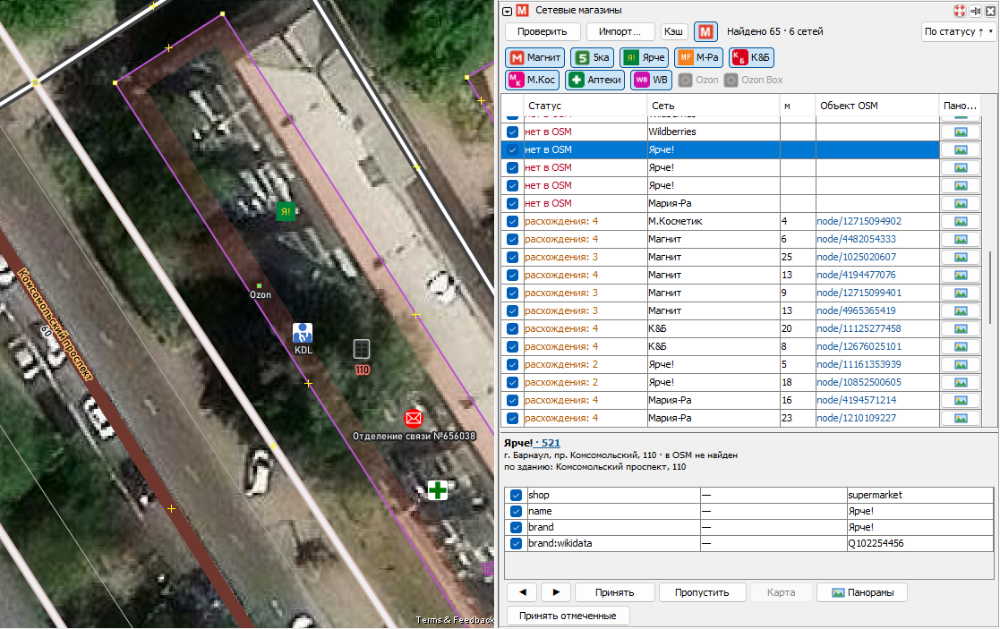
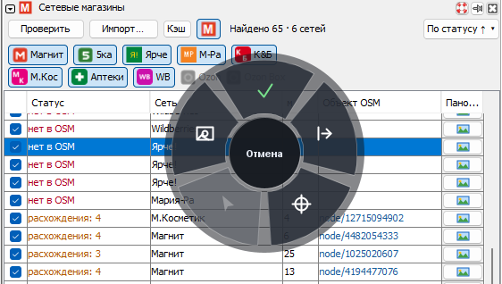

# chainpoi — сетевые магазины в JOSM

**Русский** | [English](README.en.md)

Плагин сверяет магазины торговых сетей с данными OSM: показывает, чего нет,
чего не хватает в тегах, и по галочке создаёт объекты в текущем слое.

Поддерживаются **Магнит** (`MM`, `MC`, `GM`, `MM_MINI`),
**М.Косметик** (`DG`), **Пятёрочка** (источник — база вакансий),
**Красное&Белое** (адресный каталог сети), **Wildberries**
(общий справочник ПВЗ; файл ~75 МБ скачивается после подтверждения), **Ригла**
(официальный GraphQL-список аптек), **Ярче!**, **Мария-Ра** и АЗС:
**Лукойл**, **Газпромнефть**, **Татнефть**, **ТАИФ-НК**, **Топлайн**,
**Нефтьмагистраль**.



## Как это работает

1. Загружаете область в JOSM как обычно (данные OSM должны быть в слое).
2. Меню **Данные → Проверить сетевые магазины** (или `Ctrl+Shift+F9`).
3. Плагин берёт видимую область, запрашивает магазины у сетей и сверяет
   с объектами в слое — и в обратную сторону: ищет в OSM магазины сети,
   которых у сети уже нет.
   Под кнопками — переключатели сетей со значками: нажатая сеть проверяется,
   выключенная становится серой и пропадает из таблицы, чтобы не смешивать
   все магазины сразу.
   Магнит, М.Косметик и Пятёрочка запрашиваются напрямую. Пятёрочка берётся
   из базы вакансий rabota5ka.ru, поэтому в выборку попадают только магазины,
   где идёт набор. Выключенные сети вообще не запрашиваются.
   Для **Красного&Белого** при первой проверке плагин спрашивает разрешение:
   первый раз — около 76 запросов к каталогу сети, 6–7 МБ. Плагин запоминает
   границы регионов и дальше запрашивает только те, что рядом с текущей
   областью; на диск попадают только магазины этой области. Если отказаться,
   сеть в этой проверке не участвует.
   Для **Wildberries** плагин скачивает один файл ~75 МБ (~72 тыс. ПВЗ);
   при первой проверке области спрашивается разрешение, в кэш попадают только
   ПВЗ рядом с ней. Постаматы пока пропускаются: в OSM это
   `amenity=parcel_locker`, а не ПВЗ.
   **Ригла** запрашивается одним GraphQL-запросом (~1 тыс. аптек).
   **Ярче!** — 31 региональная страница с адресами и координатами: первый раз
   все, дальше только соседние регионы. **Мария-Ра** — одна страница
   «Карта сети» с JSON-точками и часами.
   АЗС **«Лукойл»**, **«Газпромнефть»**, **«Татнефть»**, **«ТАИФ-НК»**,
   **«Топлайн»** и **«Нефтьмагистраль»** загружаются из официальных
   локаторов после подтверждения; в теги попадают виды топлива
   (`fuel:diesel`, `fuel:octane_92`, `fuel:octane_95` и т.д.).
   Кэш хранится квадратами 1°×1° и только для проверенных областей: работая
   в Краснодаре, вы не получаете на диск АЗС Дальнего Востока. Данные
   обновляются раз в 7 дней, давно не запрошенные квадраты удаляются через
   месяц. Кнопка **Кэш** удаляет все сохранённые списки; при следующей
   проверке данные скачаются заново.
   Все аптечные сети включаются одной кнопкой **Аптеки** (значок «+»).
   Для Ozon (и других сетей без открытого API) есть кнопка **Импорт…** — см.
   [bookmarklets/README.md](bookmarklets/README.md).
   Кнопка с иконкой плагина в верхнем ряду включает значки сетей на карте.
4. В таблице появляется список. Статусы:
   - `нет в OSM` — объекта нет, можно создать точку;
   - `расхождения: N` — объект есть, но значения тегов отличаются;
   - `ошибка разметки` — магазин посажен на контур здания или на вход;
   - `ок` — всё совпадает;
   - `создан` — точку создали в этом слое, но на сервер ещё не загружали;
   - `пропущен` — строку пропустили; при выключенной сортировке она остаётся
     на месте и показана серым;
   - `не проверено` — объект сети есть в OSM, но источник неполный (вакансии
     Пятёрочки): сверять не с чем, только посмотреть и открыть панорамы;
     показываются только в проверенной области;
   - `нет в данных сети` — в OSM магазин есть, у сети в этом месте его нет
     (возможно, закрылся);
   - `другое` — рядом «М.Кос» (бьюти-формат), а не М.Косметик;
     имя объекта видно в статусе строки, теги `name`/`shop` — в подробностях;
     часы работы показываются всегда (если совпадают — без галочки),
     имя и `shop` не трогаем.
5. Выбираете строку — внизу появляются подробности: адрес (полный, мелким
   шрифтом), объект OSM, расстояние, предупреждения и список полей
   **«в OSM → у сети»** с галочкой на каждое изменение (все отмечены).
   Объект на карте при этом не выделяется. Двойной клик по строке или кнопка
   **Карта** центрируют объект, ставят масштаб около 80 м, чтобы был виден
   дом, и на пару секунд подсвечивают объект; если магазина в OSM ещё нет,
   вместо подсветки на время появляется значок сети с ореолом в его точке.
   **Выделить на карте** в контекстном меню строки выделяет его без смены
   масштаба.
6. Кнопки: `◀` `▶` — перебор, **Принять** — применить к этому объекту,
   **Пропустить**, **Карта** — центрировать, **Закрылся** (для строк
   «нет в данных сети»). **Панорамы** — иконка в каждой строке таблицы
   и кнопка в подробностях: открывает Яндекс.Карты со слоем панорам.
   Те же действия есть в контекстном меню строки (правый клик):
   **Принять**, **Пропустить**, **Показать на карте**, **Выделить на карте**
   и **Панорамы**. Короткий правый клик открывает обычное меню, долгое
   удержание — круговое меню действий.
   
   Код магазина в заголовке карточки — ссылка: по клику
   открывается меню с Яндекс.Картами и 2ГИС (обе карты — в точке магазина,
   масштаб около 80 м). Ссылка `node/…` в столбце «Объект OSM» открывает
   объект на osm.org.
   Разобранные и пропущенные строки уходят вниз списка.
7. **Принять отмеченные** делает то же для всех отмеченных строк,
   с подтверждением и списком того, что изменится. Кнопка сортировки над
   таблицей показывает текущий режим, например **«По статусу ↑ ▾»**.
   В меню: по статусу, по сети, по типу и без сортировки; направление
   (возрастание/убывание) задаётся отдельно. В режиме «Без сортировки»
   строки остаются на месте и не перескакивают после применения.
8. Загрузку на сервер делаете сами, своим аккаунтом.

Overpass не используется: сравнение идёт с тем, что уже загружено в слой.
Поэтому перед проверкой скачайте область в JOSM — иначе существующие магазины
будут выглядеть как отсутствующие.

После применения объект остаётся выделенным на карте, а под таблицей
появляется напоминание: новая точка стоит по координатам сети (обычно это
вход), её стоит проверить и при необходимости перетащить. В списке полей
после применения старое значение зачёркнуто, новое показано обычным.

## Источник данных в пакете правок

Когда плагин применяет данные сети, он добавляет в пакет правок тег
`source:chainpoi` с сайтами сетей (`magnit.ru`, `rabota5ka.ru` и т. д.),
а поле `source` дополняет этими же адресами. В окне загрузки это видно
сразу на вкладке «Настройки»; на сами объекты OSM тег не ставится.

## Что именно сверяется

| Поле | Как сравнивается |
|---|---|
| `shop` | точное значение (`supermarket` / `convenience`); у «Моей цены» они равнозначны |
| `name` | без учёта регистра, ё/е, кавычек; «магазин Магнит» ≠ «Магнит» |
| `brand`, `brand:wikidata` | точное значение |
| `operator` | без учёта кавычек и «АО» |
| `opening_hours` | без пробелов; `Mo-Su 09:00-21:00` ≠ `Mo-Su 08:00-20:00` |
| `addr:street`, `addr:housenumber` | только если уже стоят на объекте |

Магазин может быть точкой, **полигоном** или **мультиполигоном** — это не ошибка.
Ошибка — точка на контуре здания (вершина `building=*`) или на объекте
с `entrance`/`door`.

Название, часы и оператор плагин считает зоной ответственности сети:
расхождения показываются и по умолчанию предлагаются к замене.

`branch` не создаётся (в API Магнита его нет), но если он есть в OSM —
показывается в подробностях.

## Как проверялось

Логика провайдера, сверки и применения команд проверена без интерфейса
(папка `test`, `javac` + `java` против `josm-latest.jar`):

- `TestFetch` — реальный запрос к API Магнита, разбор ответа и тегов;
- `TestMatch` — значения тегов (часы, «магазин Магнит», оператор), полигон,
  мультиполигон, точка на контуре здания, вход/дверь, далёкий объект,
  «Магнит Косметик» и «Магнит Аптека» рядом (не должны считаться Магнитом),
  плюс М.Косметик: старое имя, новое имя, `shop=cosmetics` ≡ `chemist`;
- `TestApply` — сборка команд: создание точки без адреса, выборочное
  применение полей (снятая галочка не применяется), закрытие магазина
  (`shop` → `disused:shop` + `check_date`), неотмеченные строки;
- `TestReal` — сверка на реальных данных OSM, скачанных через API.

Запуск одной командой, результат — в `test/report.txt`:

```
powershell -NoProfile -ExecutionPolicy Bypass -File test/run-tests.ps1
```

В JOSM вручную проверены: появление панели, кнопка «Проверить»,
создание отсутствующего магазина кнопкой «Принять», выделение новой точки,
напоминание под таблицей и обновление таблицы после применения.

## Теги

Создаётся узел с тегами:

```
shop=supermarket            (MM, MC, GM)   convenience для MM_MINI
name=Магнит
name:ru=Магнит
name:en=Magnit
brand=Магнит
brand:wikidata=Q940518
operator=АО «Тандер»
opening_hours=Mo-Su 08:00-20:00
```

Адресные теги не добавляются: если точка внутри здания, адрес уже есть
у контура, а дублировать его на точку — спорно. В подробностях адрес
показывается подсказкой «по зданию: …».

Набор совпадает с пресетом Магнита в iD/NSI (`shop`, `brand`, `brand:wikidata`,
`name`, `name:ru`, `name:en`) плюс `operator` и `opening_hours`. `brand:en`/`brand:ru`,
контакты сети и `brand:wikipedia` из российского пресета намеренно не добавляются.

Для «Красное&Белое» создаётся `shop=alcohol`, `name`/`name:ru` и `brand`
= «Красное&Белое», `brand:wikidata=Q24933790`, `opening_hours` из каталога.
Так размечены 98% объектов сети в OSM; адрес, как и у Магнита, не дублируется.

Для Wildberries создаётся `shop=outpost`, `name`/`name:ru`/`brand` = Wildberries,
`brand:wikidata=Q24933714`. Постаматы и локеры не создаются — для них в OSM
другая схема тегов.

Для «Риглы» — `amenity=pharmacy`, `name`/`name:ru`/`brand` = «Ригла»,
`brand:wikidata=Q4394431`, `healthcare=pharmacy`. Из общего списка группы
берутся только точки с «Ригла» в названии, партнёрские аптеки не трогаем.

Для «Ярче!» — `shop=supermarket`, `name`/`brand` = «Ярче!»,
`brand:wikidata=Q102254456`. Координаты берутся из `data-coords` на сайте.

Для «Марии-Ра» — `shop=supermarket`, `name`/`brand` = «Мария-Ра»,
`brand:wikidata=Q4281631`. Если на карте указаны часы, добавляется
`opening_hours`.

Для АЗС создаётся `amenity=fuel`, `name`/`brand` соответствующей сети
и `brand:wikidata`. Виды топлива из официальных локаторов превращаются
в `fuel:diesel`, `fuel:octane_80/92/95/98/100`, `fuel:lpg`, `fuel:cng`
и `fuel:lng`.

Для 52 сетей АЗС без открытого API добавлены профили распознавания и импорта
(Роснефть, Teboil, Газпром, Башнефть, Калина Ойл, Движение,
ОРТК, ВТК, ПРАЙМ, Балтнефть, ЛТК, Киришиавтосервис, Атан, Rusoil,
ОПТИ, Уфимнефть, PNB, Южная нефтяная компания, Газойл, КНП, Экойл,
Нефтехимпром, V&V, Ликом, Сургутнефтегаз, TamicEnergy, Get Petrol,
УралКонтрактНефть, Зюраткуль, Нягань-газ, Октан, БРК, Люксойл, Крайснефть,
Регион 24, Ника, Газнефтепродукт, ТрансСиб, Сибирьнефть, ННК,
Саханефтегазсбыт, Нефтемаркет, Туймаада-нефть, Октант, Benzo, НК Уссури,
Дальнефтепродукт, ЕКА, ТЭС, IRBIS, Трасса и Сибнефтепродукт). Они не качают
данные и не занимают кнопок в панели: точки можно загрузить через
**Импорт…**, а объекты в OSM плагин узнаёт по `brand`/`name`.

**«Нефтьмагистраль»** (Москва и Московская область, около 105 АЗС) парсится
с официальной карты `neftm.ru`: адрес, координаты, номер станции в `ref`
и виды топлива из фильтров.

У **«Топлайна»** (Омск и восточное направление, 60 АЗС) включён эксперимент:
сначала плагин ищет объект по текстовому адресу — `addr:street` +
`addr:housenumber`, без опоры на координаты. Если адрес в OSM не найден,
работает обычный поиск по координатам. Совпадение по адресу помечается
в подробностях предупреждением, чтобы его можно было проверить глазами.

Номер АЗС по правилам OSM хранится в `ref` — без «№» и слова «АЗС»,
например `ref=5`. А `name` — это бренд или собственное название станции,
не «АЗС №5». Если в `name`
встретился номер, плагин показывает предупреждение и предлагает перенести
номер в `ref`, а `name` привести к названию сети.

## Форматы магазинов

| Код API | Что это | Как обрабатывается |
|---|---|---|
| `MM` | Магнит | `shop=supermarket` |
| `MC` | Магнит «Моя цена» | `shop=supermarket` |
| `GM` | Магнит Семейный | `shop=supermarket` |
| `MM_MINI` | Магнит Мини | `shop=convenience` |
| `DG` | М.Косметик | отдельная сеть, `shop=chemist` |
| — | Пятёрочка | `shop=supermarket`, источник — вакансии |
| `DARKSTORE` | Мигом | пропускается |
| `ZARYAD` | Заряд | пропускается |
| `MO`, `ME` | не выяснено | пропускается |

`DG` проверено по адресу: Гулькевичи, ул. Ленинградская 20 — в API `DG`.
`MC` проверено по адресу Расшеватская 95, Темижбекская.

### М.Косметик

14.11.2025 «Магнит» официально перезапустил сеть: «Магнит Косметик» → **«М.Косметик»**
(дрогери и household). Бьюти-сторы с фокусом только на косметике и парфюмерии —
отдельный бренд **«М.Кос»**; это уже не дрогери, поэтому `shop=cosmetics`
у объекта «М.Косметик» считается ошибкой и предлагается заменить на `shop=chemist`.

Считается отдельной сетью: магазины `DG` сверяются только с объектами,
где в `name`/`brand` есть «косметик», и не путаются с обычным Магнитом.

Новые точки создаются с `name=М.Косметик`, `name:ru=М.Косметик`,
`brand=Магнит Косметик`, `shop=chemist`.

У существующих объектов `name` и `name:ru` — обычные расхождения: показываются
и предлагаются к применению (ребрендинг официальный, решение по каждому объекту
за вами). `brand` у М.Косметик плагин не трогает.

Бьюти-кластер «М.Кос» API не различает: все косметические магазины приходят
как `DG` и считаются М.Косметик. Это редкость — бьюти-сторы есть только
в крупных городах (около 10% сети), так что на практике почти не встречается.
Если объект в OSM назван «М.Кос», плагин показывает его как «другое»
и сверяет только часы работы.

Рядом с расхождением имени показывается уведомление: переименование взято
из официального ребрендинга сети, а **не из решения сообщества OSM**, и на
панорамах вывеска может быть старой. Кнопка **Панорамы** открывает Яндекс.Карты
со слоем панорам на магазине — дальше клик по синей линии.

Смотреть карту можно, а **использовать её данные — нет**: разрешены только
фотографии панорам, без картографической подложки, адресных меток и спутниковых
снимков
(см. [RU:Россия/Яндекс.Панорамы](https://wiki.openstreetmap.org/wiki/RU:%D0%A0%D0%BE%D1%81%D1%81%D0%B8%D1%8F/%D0%AF%D0%BD%D0%B4%D0%B5%D0%BA%D1%81.%D0%9F%D0%B0%D0%BD%D0%BE%D1%80%D0%B0%D0%BC%D1%8B)).
Плагин сам ничего с карты не читает — только открывает её в браузере.

## Сборка

Gradle не нужен, сборка против локального `josm-latest.jar`.

Windows:

```
powershell -NoProfile -ExecutionPolicy Bypass -File build.ps1
```

macOS и Linux:

```
./build.sh
JOSM_JAR=/путь/к/josm-latest.jar ./build.sh
```

Пути к JDK и jar заданы в начале `build.ps1`; в `build.sh` путь к jar берётся
из `JOSM_JAR` (по умолчанию `~/Downloads/josm-latest.jar`). Нужен JDK 17+.

## Установка

Готовые сборки — в [релизе](https://github.com/Glebzilla/josm-chainpoi/releases):
`chainpoi-0.3.5-windows.zip` для Windows и `chainpoi-0.3.5-macos-linux.zip`
для macOS и Linux. Внутри jar, скрипт установки и короткая инструкция.

**JOSM должен быть закрыт**: иначе он перезапишет `preferences.xml` при выходе.
Плагин лежит в каталоге настроек JOSM — он разный по системам:

| Система | Каталог JOSM |
|---|---|
| Windows | `%APPDATA%\JOSM` |
| macOS | `~/Library/Preferences/JOSM` |
| Linux | `~/.config/JOSM` (или `~/.josm`, если эта папка существует) |

### Windows

```
powershell -NoProfile -ExecutionPolicy Bypass -File install.ps1
```

Скрипт копирует `chainpoi.jar` в `plugins`, делает бэкап `preferences.xml`
и добавляет `<entry value='chainpoi'/>` в список плагинов.

### macOS и Linux

```
sh install.sh
```

Скрипт сам находит каталог JOSM по таблице выше, копирует jar, делает бэкап
`preferences.xml` и добавляет запись. Если каталога `plugins` ещё нет —
запустите JOSM один раз, закройте и повторите.

### Вручную (любая система)

1. Закрыть JOSM.
2. Скопировать `chainpoi.jar` в `<каталог JOSM>/plugins/`.
3. В `<каталог JOSM>/preferences.xml` найти `<list key='plugins'>` и добавить
   строку `<entry value='chainpoi'/>`.
4. Запустить JOSM.

## Удаление

Закрыть JOSM, удалить `<каталог JOSM>/plugins/chainpoi.jar` и строку
`<entry value='chainpoi'/>` из `<list key='plugins'>` в `preferences.xml`.

## Ограничения

- Провайдеры: Магнит (вместе с М.Косметик) и Пятёрочка. Остальные сети
  подключаются через интерфейс `ChainProvider`.
- Сверка по расстоянию (100 м) и совпадению названия/бренда. Сеть «Магнит
  Косметик» и «Магнит Аптека» намеренно не считаются Магнитом.
- Адрес не добавляется: он обычно уже есть у здания. Адрес с контура
  показывается подсказкой в подробностях.
- Новая точка ставится по координатам сети — обычно это вход в магазин,
  поэтому она может оказаться чуть вне контура здания. После применения
  точка остаётся выделенной, её можно сразу перетащить.
- «Нет в данных сети» — только подсказка: расстояние бывает большим,
  поэтому решение о закрытии принимает человек (кнопка «Закрылся»).
- Пятёрочка: источник — вакансии rabota5ka.ru, поэтому видны только магазины,
  где идёт набор; закрытые по ним не определяются. Координаты в вакансиях
  бывают неточными, поэтому радиус сверки для неё увеличен до 250 м.
- Кнопка «Панорамы» открывает Яндекс.Карты со спутником и слоем панорам,
  но панорамы есть не везде. Смотреть карту можно, а использовать её данные
  (подложку, метки, снимки) — нельзя, разрешены только фотографии панорам.
- Плагин ничего не загружает на сервер OSM.
- Данные берутся с сайта сети. Перед загрузкой стоит убедиться, что магазин
  действительно там: спутник, панорама, на местности.

## Дальше

- Ozon — отложен: карта отдаёт точки тайлами/виджетом, нужен отдельный разбор.
  Wildberries уже поддержан через статический JSON. Банкоматы ВТБ — после этого.
- Подсветка предложенных точек на карте отдельным временным слоем.
- Настройка порога расстояния и набора проверяемых тегов.
- Подстановка адреса (`addr:*`) из контура здания по отдельной галочке.

## Разработка

Часть кода и документации подготовлена с помощью ИИ, затем проверена,
собрана и протестирована автором. Плагин никогда не загружает данные на
сервер OSM автоматически.

## Лицензия

GPL-3.0, см. [LICENSE](LICENSE).

## См. также

- [RU:Россия/Яндекс.Панорамы](https://wiki.openstreetmap.org/wiki/RU:%D0%A0%D0%BE%D1%81%D1%81%D0%B8%D1%8F/%D0%AF%D0%BD%D0%B4%D0%B5%D0%BA%D1%81.%D0%9F%D0%B0%D0%BD%D0%BE%D1%80%D0%B0%D0%BC%D1%8B) —
  что можно и что нельзя брать из панорам.
- [RU:Правовые вопросы и ответы](https://wiki.openstreetmap.org/wiki/RU:%D0%9F%D1%80%D0%B0%D0%B2%D0%BE%D0%B2%D1%8B%D0%B5_%D0%92%D0%BE%D0%BF%D1%80%D0%BE%D1%81%D1%8B_%D0%B8_%D0%9E%D1%82%D0%B2%D0%B5%D1%82%D1%8B) —
  почему чужие карты нельзя использовать как источник.
